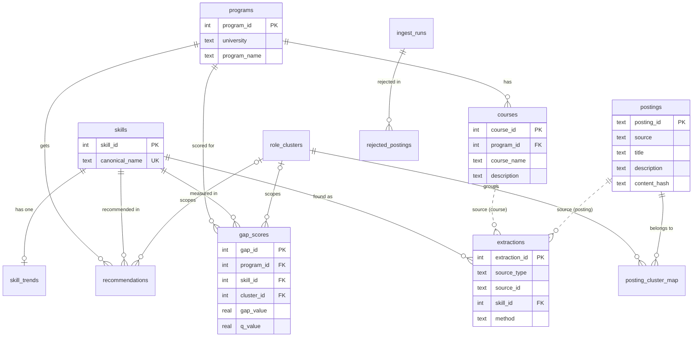

# Database design

AlignED stores its data in one SQLite file, `database/aligned.db`. `database/schema.sql` is the source of truth
(schema version 2). This page explains the model, the rules the database enforces, and the trade-offs behind it.

## Entity relationship diagram

Dotted lines are relationships the database cannot enforce with a foreign key (see decision 2 below).

## Tables

| Table | Rows | What it holds |
|---|---|---|
| `programs` | 13 | One row per graduate program (university + program name). |
| `courses` | 1,378 | Course name and description for each program. |
| `postings` | 1,665 | Job postings. `source = 'kaggle_sample'` marks the 1,660 used in every statistic; `adzuna` rows come from the daily feed and are stored, not counted. |
| `skills` | 1,597 | The O*NET skill vocabulary. |
| `extractions` | 8,976 | Which skills were found in which course or posting, and by which method. |
| `gap_scores` | 1,040 | For each program and skill: course coverage, market demand, gap, raw p-value, corrected q-value, and which test was used. |
| `recommendations` | 724 | Ranked "learn this next" rows derived from significant gaps. |
| `skill_trends` | 67 | Weekly demand trend per skill, with a corrected q-value. |
| `role_clusters`, `posting_cluster_map` | 11 / 1,660 | Job families from embedding-based clustering, and which cluster each posting is in. |
| `ingest_runs`, `rejected_postings` | audit | One row per daily ingestion run and each rejected posting with its reason. |

## Rules the database enforces (version 2)

- **Natural keys are unique.** A program is unique by university and name; one extraction per text, skill and method;
  one gap row and one recommendation per program, skill and scope; one trend per skill.
- **Values are in range.** Rates, p-values and q-values are between 0 and 1; salaries are not negative; counts are not negative.
- **Labels are from a fixed list.** `source_type` (course, posting), `method` (baseline_keyword, llm), `test_method`
  (z_test, fisher_exact), `priority_tier` (high, medium, low), `trend_label`, and the posting `source`.
- **Foreign keys are on** for every connection, and `PRAGMA foreign_key_check` runs after every rebuild and migration.

`tests/test_database_constraints.py` inserts bad rows and checks each one is rejected.

## Design decisions and trade-offs

1. **SQLite, not Postgres.** One file, no server, easy for anyone to clone and run, and fast enough for about 10,000
   rows. The cost is limited concurrent writes and no network access. The dbt project and SQL are portable, so moving to
   Postgres means changing the connection and a few types, not the model. I would move if the daily job and the app had to write at the same time, or if the data grew past what one file handles comfortably.
2. **`extractions.source_id` is polymorphic.** It holds a course id or a posting id depending on `source_type`, so it
   cannot have a foreign key. The alternative is two link tables (`course_skills`, `posting_skills`), which is cleaner but
   doubles every query. I kept one table and a test that every `source_id` resolves. If the model grew, splitting is the next step.
3. **`NULL` means "overall market" in `cluster_id`.** SQL treats NULLs as distinct, so a plain UNIQUE would allow duplicate
   overall-market rows. The unique index uses `COALESCE(cluster_id, -1)` so the natural key holds in both cases.
4. **Derived tables are rebuilt, not edited.** `gap_scores`, `recommendations` and `skill_trends` are deleted and
   recomputed from `extractions` each run. That keeps one direction of data flow and makes results reproducible. The rebuild writes to
   a temporary file and swaps it in only after validation, so a failed run never damages the working database.
5. **Mostly normalized (third normal form), with deliberate copies.** `recommendations.gap_value` and `trend_label` repeat
   values from other tables so the app can read a recommendation without joins. They are recomputed together, so they cannot drift.
6. **Statistics are stored, not recomputed.** Each gap row keeps its p-value, corrected q-value and test method, so any
   number in the app can be traced to the test that produced it.

## Indexes, and the queries they serve

| Index | Serves |
|---|---|
| `idx_extractions_lookup (source_type, method, skill_id, source_id)` | Counting how many postings or courses mention a skill. This was a full table scan before version 2 and is now a covering index search. |
| `idx_gap_scores_program_cluster`, `idx_recommendations_program_cluster` | The Skill Gaps page: one program, one scope. |
| `idx_gap_scores_skill` | Key Findings: a skill across all programs. |
| `idx_courses_program`, `idx_cluster_map_cluster`, `idx_rejected_run` | Foreign-key lookups and joins. |
| `uq_gap_scores_key`, `uq_recommendations_key` | Natural-key uniqueness (also used as lookup indexes). |

## Scaling

At 10 thousand rows, performance is not a concern. If this grew 100 times, the first changes would be Postgres, partitioning
`extractions` by `source_type`, and storing the daily feed in a warehouse table with an incremental dbt model, since the
daily job already deduplicates by id and content hash.

## Changing the schema

SQLite cannot add CHECK or UNIQUE constraints to an existing table. `python scripts/migrate_schema.py` builds a new file from
`schema.sql`, copies every row by column name, verifies row counts, foreign keys and integrity, and only then replaces the
original. If any existing row breaks a new rule, it stops and leaves the original untouched. The schema version is stored in
`PRAGMA user_version`.
